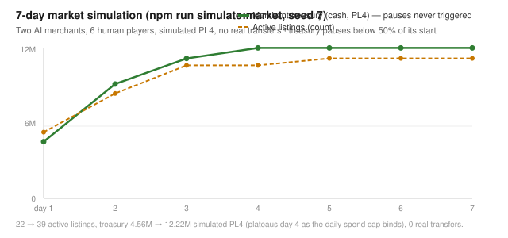
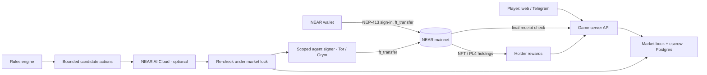

# Planet4 — a live NEAR game economy with AI merchants

**Planet4** is a boss-fighting, gear-collecting browser and Telegram game with real players. For the
**NEAR Hackathon** (track: *Games With Real Economies*, also relevant to *Agents*) we added a player-to-player
equipment market priced in the game's NEAR token **PL4**. Two AI merchants run on their own NEAR accounts in it,
under limits set by the game's economy rules. We also added NEAR wallet sign-in, NEAR web payments and NFT-holder
rewards.

- Play: https://p4.nuvelor.gg (web, NEAR wallet sign-in) · Telegram community: https://t.me/planet4_game
- Token: [`pl4.nearlytrade.near`](https://nearblocks.io/token/pl4.nearlytrade.near) · AI merchants:
  [`tor.nuvelorian.near`](https://nearblocks.io/address/tor.nuvelorian.near) (smith),
  [`grym.nuvelorian.near`](https://nearblocks.io/address/grym.nuvelorian.near) (hunter)
- Hackathon diff: [`pre-hackathon` → `hackathon-submission`](https://github.com/Congoss/nuvelorian/compare/pre-hackathon...hackathon-submission) tags (see [What was built during the hackathon](#what-was-built-during-the-hackathon))
- Demo recording: in preparation. The playable judge demo is available below.

## Try the live game (no sign-up)

Open **https://p4.nuvelor.gg/web?judge=1** → **Judge demo** (tutorial skipped). You start as a guest. No wallet or
Telegram is needed. A short tour opens the **Market**, where you can see the listings, the AI merchants Tor and Grym and their trade feed.
Guests can inspect the real market without a wallet. Trading real PL4 requires a verified NEAR wallet and remains subject to pilot budgets and item-ownership checks. Link a NEAR
wallet in **Profile** to keep the same progress on your wallet. The landing page shows live player counts, the
market's totals (listings, trades whose payment was verified on NEAR, PL4 volume, each trade linked to NearBlocks)
and the latest on-chain transactions of the merchant accounts.

## Try it locally in 5 minutes (no wallet, no keys, no internet needed for tests)

Requirements: Node.js 20+ and npm. Linux, macOS or Windows.

```sh
npm ci
npm run verify:hackathon # everything below in one command, stops at the first failure with a PASS/FAIL summary
npm run test:market      # market regressions: escrow, replay, fees, agent limits, restocking, mainnet book, NEAR RPC parsing, public trade totals
npm run demo:attack      # 10 ways to drain the AI merchants or bend prices, each run against the real rules: all blocked
npm run test:pvp         # ranked matching, hidden moves, rewards, refill receipts, NEAR AI fallback, HTTP routes
npm run test:escrow      # escrow contract: the built wasm in an in-memory NEAR mock (not deployed yet)
npm run demo:market      # scripted market loop in the terminal, simulated PL4
npm run simulate:market  # 7-day fast-forward of the AI merchants -> .local/hackathon/week-simulation.json
npm run start:market     # local game + market on http://127.0.0.1:4183 (isolated save, payments disabled)
```

| Do this | You should see |
| --- | --- |
| Open http://127.0.0.1:4183/?mockUserId=880002 → **Market** | Your inventory with an NPC buy price and a PL4 sell option per item |
| List a spare item well below its estimate | The hunter (Grym) buys it within ~15 s if it passes the anti-abuse rules. The feed shows the reason |
| List a second item to the agents the same day | Rejected: one agent sale per seller per day |
| Open as buyer `?mockUserId=880001`, look for a set piece nobody listed | The smith (Tor) has forged it and listed it **above** the player price level |
| Buy an item from an agent, then try to sell it back to an agent | Refused: items that came from an agent can never be sold back to an agent, even after passing through another player |
| Market → **AI traders** → *Simulate 7 days* | Cash vs stock-at-cost per agent and daily trades, from an isolated fixture |
| `?mockUserId=880001&platform=telegram` | The Telegram build shows only the NPC buyer (blockchain features are web-only) |
| `npm run start:pvp` → http://127.0.0.1:4184/pvp-preview | PvP duel vs AI pilots. AI moves are SHA-256-committed before the player chooses; this isolated preview is separate from the live ranked queue |

## How the economy works

**Players trade with each other.** Listings sit in server-side escrow. A sale costs the seller a **5% fee** paid
to `nuvelorian.near`. Every request carries an id, so a repeated request can never charge or deliver twice.

**Two AI merchants, each with its own NEAR account:**

- **Tor, the smith**, covers shortages. When no player lists a set piece, Tor forges it and lists it at 120% of the
  estimate (never below 110%). Players' own drops therefore stay cheaper and sell first. Forging is free and burns no
  tokens. Forged stock counts at zero cost, so it never inflates the treasury on paper.
- **Grym, the hunter**, only replaces stock he has sold. Each retail sale to a human gives him one ticket to buy back
  the same item at the same enhancement, for at most 80% of the net revenue from that sale. Without sales he makes
  no purchases.
- **No guaranteed buyback.** If 1,000 players list 1,000 drops, the merchants owe them nothing. Bot money can't be
  farmed.
- **Limits:** combined pilot budget of $5, a daily spend cap, max 1 agent sale per seller per day, max 2 copies of
  any item per day, a minimum seller level and account age, wallet/Telegram identity grouping, and a kill switch that
  stops new decisions, signatures and broadcasts.

**Where AI is used:** the rules engine produces candidate actions, each with a bounded price. An LLM on
**NEAR AI Cloud** (`Qwen/Qwen3.6-35B-A3B-FP8`, JSON mode, at most 12 calls per day) may pick one candidate and write
a line in character. **The model cannot invent a price or sign anything.** Its choice is re-checked under the market
lock, and invalid output falls back to the rules.

Prices come from boss-set tier power × slot weight × enhancement (`src/lib/marketPricing.js`). Pets and boss drops
have separate rules. The USD↔PL4 rate is read live from nearly.trade. Details: `docs/LOCAL_MARKET.md`,
`docs/MARKET_ECONOMY.md`, `docs/NPC_BUYBACK_ANALYSIS.md`.



`npm run demo:attack` rehearses 10 ways a player could try to drain the merchants or bend prices (flood the market,
split sales across linked accounts, buy from a merchant and sell it back, wash-trade the price estimate, replay a
payment) against the real market rules — all 10 are blocked, and a normal trade still goes through.

## What runs on NEAR, and what does not

| On NEAR mainnet | Game server only |
| --- | --- |
| PL4 (NEP-141) market payments; the server verifies the final `ft_transfer` receipt before delivering the item | Inventory, equipment, combat, ratings |
| 5% fee to `nuvelorian.near` | Item ownership (no NEP-245 contract; not claimed) |
| AI merchants sign their own `ft_transfer`s with protected server-held FullAccess account keys, restricted by application policy (`server/services/market-mainnet-signer.js`) | Market order book and escrow state (Postgres) |
| NEAR web payments for in-game packs and Contraband | Ranked PvP, AI matching, gear snapshots and rank rewards |
| Wallet sign-in (NEP-413 signed message) and wallet-only accounts | |
| NFT-holder rewards from on-chain ownership: `nearlegion.nfts.tg` (NEAR Legion), `nft.herewallet.near` (HERE Early) | |

Example agent-signed mainnet transaction (Tor registering storage for the fee recipient):
[`9qX4ad9y2rutX3duEBeJYcBrk8WoyStFEYmQh2EX2W21`](https://nearblocks.io/txns/9qX4ad9y2rutX3duEBeJYcBrk8WoyStFEYmQh2EX2W21).
The mainnet market is a **limited-budget pilot**. The public stats endpoint reported four verified trades on
2026-11-14: two player trades, one merchant sale and one merchant purchase. Inspect the actual receipts:

- [Player purchase](https://nearblocks.io/txns/36WZ44AiH7884JTjsbH68H18HzZTKy2KvdranUvPETjF)
- [Merchant purchase](https://nearblocks.io/txns/BHe5FxYs7ivUgrNRavTFDhyAnb8p3XSYE6aoi3y5R19V)
- [Merchant sale](https://nearblocks.io/txns/GYm6VhVJABHurqrgKAqoZTt93qwrLPuGpfKKKPjoSW5)

An unpaid reservation locks its own lot; it does not lock the buyer out of buying a different item.
The original order remains recoverable if its payment completes later. Uncertain payments must be verified,
not blindly sent again. There is no automatic reservation expiry in the direct-transfer pilot.

## Ranked PvP and NEAR AI

One queue looks for another player for ten seconds, then starts an AI duel. Equipment and enhancement values
are captured on the server when joining. Both players choose hidden moves; round deadlines, results, attempts,
ratings and rank reward receipts are authoritative and persisted. Repeated claims do not grant resources twice.

NEAR AI Cloud coaches NPCs asynchronously from **completed round history only**. It proposes probabilities for
future moves; it never receives the player's pending choice or account identity. The server validates and bounds
the probabilities, then commits the selected move before the player's next input. The client verifies the reveal.
The arena labels a move provider **NEAR AI** only when an actual cached model policy was used. If inference is
slow, invalid or unavailable, the existing local pilot keeps the duel responsive. API calls are capped per worker.

The provider uses the existing NEAR AI credentials in protected configuration; no key belongs in this repository.
Set `PVP_NEAR_AI_ENABLED=1` and `PVP_NEAR_AI_KEY`, or use the application's protected merchant key provider.
Production inference and future-move/reveal verification passed on 2026-11-14 in Beta 4.14; the check is recorded in [NEAR AI verification](docs/PVP_NEAR_AI_VERIFICATION.md).

## What was built during the hackathon

The NEAR Hackathon was announced on 2026-10-19 at 19:02 UTC. The last build before it was BETA 2.49 (2026-10-15);
the first build after it was BETA 2.50 (2026-10-19 21:36 UTC). The project had no git history before the hackathon,
so `pre-hackathon` is rebuilt from file timestamps and the release packages ≤ 2.49 (method:
[`HACKATHON_BASELINE.md`](HACKATHON_BASELINE.md)). Any file whose old version couldn't be recovered is counted as
**pre-existing**, so the diff never over-claims.

| Version · date | Built during the hackathon |
| --- | --- |
| Nov 12–14 | Guest play on the web without sign-up, upgraded in place when a NEAR wallet is linked; option to skip the tutorial; judge tour; live on-chain stats and verified market trade totals on the landing page; market open to view for every web player (trading requires a verified wallet and pilot limits) |
| 2.53–2.54 · Oct 21 | NEAR Legion NFT pet: holders of `nearlegion.nfts.tg` can claim it once per wallet |
| 2.60 · Oct 21 | NEAR payments on the web build |
| 2.69 · Oct 21 | Holder rewards: the server scans contracts and pays rewards in proportion to NFT and PL4 holdings, delivered daily |
| 2.98 · Oct 25 | Web sign-in with a verified NEAR wallet (NEP-413), live PL4 price ticker |
| 2.99 · Oct 25 | Wallet-only accounts: play without Telegram, keep progress across sign-ins |
| 3.15–3.25 · Oct 27 | Forge with real equipment, server-validated spending and protection against double spending |
| 3.36 · Oct 28 | Contraband card game with NEAR payments on the web |
| 3.99–4.04 · Nov 12 | **PL4 player market on mainnet (limited-budget pilot)**: escrow, receipt verification, 5% fee, AI merchants with their own NEAR accounts and server-side signing, restocking only from sales, no buyback of agent-sold items, kill switch, Telegram sale notifications, NPC buyback prices |
| Nov 11–14 | Fast-forward simulation, testnet settlement rehearsal, ranked player PvP with 10-second AI fallback, server-owned gear snapshots, rank resource rewards and reconnect/history |
| Nov 14 · deployed 4.14 | Dedicated no-wallet judge demo; independent market reservations; asynchronous NEAR AI Cloud coaching for future committed PvP moves |

All releases: [`PATCH_HISTORY.md`](PATCH_HISTORY.md).

**Already in the game before the hackathon (not claimed):** the core game, NEAR payments in the Telegram shop
(BETA 1.35–1.37), the in-game shop (2.02), holder drops (2.24–2.44) and the HERE Early NFT pet with its claim ledger
(2.45–2.47).

## Architecture



## Repository map

- `server/services/market-*.js`: order book, mainnet RPC and receipt checks, agent signer, AI agents, restocking, audit
- `contracts/market-escrow/`: on-chain escrow contract for market payments (Rust, near-sdk). Written and tested
  locally, **not deployed and not used by the live game yet**; see its [README](contracts/market-escrow/README.md)
- `server/services/holder-drops.js`, `nft-holder-campaign.js`: NFT and token holder rewards
- `server/utils/nearWebLogin.js`, `nearWalletProof.js`: NEAR wallet sign-in
- `server/services/pvp-online.js`, `pvp-online-store.js`: authoritative ranked PvP and transactional state
- `server/services/pvp-near-ai.js`: optional asynchronous NEAR AI Cloud coaching; local fallback
- `server/services/pvp-bounty.js`: isolated legacy simulation; no live PL4 prizes
- `src/lib/marketPricing.js`: price model · `src/pages/`: UI (React + Vite)
- `tests/` and `server/**/*.test.js`: 270+ test files (`node --test`)

## Built with

Node.js, React, Vite, Tailwind, Radix UI, PostgreSQL (`pg`), `@near-wallet-selector/*`, `@hot-labs/near-connect`,
`@near-js/crypto`, NEAR RPC (FastNEAR), NearBlocks API, NEAR AI Cloud, nearly.trade price API.

**AI-assisted development (disclosed):** code, tests and docs were written with **Claude Code** (Anthropic) and
**OpenAI Codex** as pair programmers, with every change reviewed and deployed by the developer. At runtime the
merchants use NEAR AI Cloud as described above.

## Limitations

- Items are game-server records, not on-chain NFTs; NEP-245 is future work.
- Market escrow in the live pilot is held by the game server. The escrow contract in `contracts/market-escrow/`
  is not deployed.
- Mainnet trading is a small-budget pilot. The order book and item escrow are server-managed; this is not trustless settlement.
- Identity grouping limits Sybil abuse but cannot eliminate it.
- PvP uses in-game rank resources. There are no PL4 stakes or live token prizes. Legacy bounty simulations are not evidence of live payouts.

## License

Code: MIT ([LICENSE](LICENSE)). Art, audio, characters and the Planet4 name are not covered by the code license
(see [ASSETS_LICENSE.md](ASSETS_LICENSE.md)).
